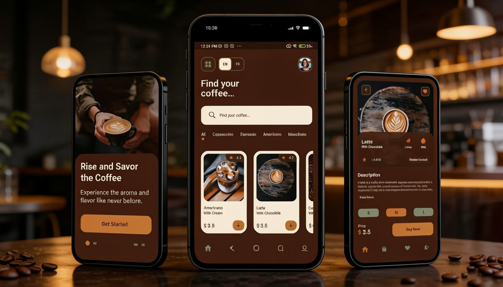
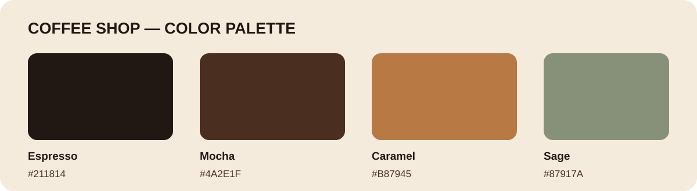

# Coffee Shop App

<p align="center">
  
</p>

<p align="center">
  A Flutter coffee shop application with a warm, modern interface for discovering coffee and exploring drink details.
</p>

<p align="center">
  **Built with Flutter · Dart · Material Design**
</p>

---

## Overview

Coffee Shop App is a mobile application prototype focused on creating a simple and enjoyable coffee-browsing experience.

It brings together an introduction screen, a coffee discovery home screen, and a product detail screen in one cohesive design.

The interface features a warm coffee-inspired visual identity, rounded surfaces, expressive product imagery, and compact navigation.

## Features

- **Introduction:** A welcome screen that introduces the application.
- **Coffee Discovery:** Browse available coffee products and explore different categories.
- **Search:** Find coffee by name or ingredients.
- **Product Details:** View descriptions, prices, and product information.
- **Coffee Customization:** Select available coffee sizes.
- **Favorites:** Toggle the favorite state of coffee products.
- **Language Support:** Switch between English and Turkish.
- **Responsive Layouts:** Scrollable screen content for shorter displays.

## Design System

The visual identity is based on a warm, coffee-inspired color palette combining deep espresso tones, creamy surfaces, caramel accents, and muted sage green.

<p align="center">
  
</p>

| Color | Hex |
|---|---|
| Espresso | `#211814` |
| Mocha | `#4A2E1F` |
| Caramel | `#B87945` |
| Vanilla | `#F5EBDD` |
| Sage | `#87917A` |

## Technologies

- Flutter
- Dart
- Material Design
- Flutter Localization
- Google Fonts
- SVG Rendering

## Getting Started

### Requirements

- Flutter SDK
- Dart SDK
- Android Studio
- Android emulator or a connected Android device

### Installation

Clone the repository:

```bash
git clone https://github.com/sinasagatchi/coffee_shop_app.git
```

Navigate to the project directory:

```bash
cd coffee_shop_app
```

Install dependencies:

```bash
flutter pub get
```

Run the application:

```bash
flutter run
```

## Project Structure

```text
coffee_shop_app/
├── assets/
│   └── readme/
│       ├── coffee-shop-banner.png
│       └── color-palette.svg
├── lib/
│   ├── data/
│   ├── entities/
│   ├── l10n/
│   ├── ui/
│   │   ├── screens/
│   │   ├── theme/
│   │   └── widgets/
│   ├── app_locale_scope.dart
│   └── main.dart
├── test/
├── l10n.yaml
├── pubspec.yaml
└── README.md
```

## Application Status

This project is an evolving Flutter application prototype.

The current scope focuses on the existing introduction, home, and coffee detail screens.

The purchase button currently displays a preview message. Checkout, order management, and payment processing are outside the current project scope.

## License

This project is based on the original Flutter Coffee Shop App repository by [ivansaul](https://github.com/ivansaul/flutter_coffee_shop_app).